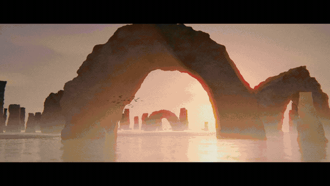

<p align="center">
  
</p>

# rubydai-make-video-skill

**Phim viết bằng code.** Phim ngắn, video YouTube dài, quảng cáo, video giải thích và MV. Bạn mang ý tưởng và gu thẩm mỹ; một AI coding agent viết kịch bản, dựng từng khung hình bằng code, thiết kế âm thanh và giao cho bạn một file MP4 hoàn chỉnh.

> Dự án được phát triển tiếp từ [cinecode](https://github.com/sarpstar/cinecode) của Sarp Yıldız (giấy phép MIT). Xem mục [Ghi công](#ghi-công).
>
> **Trạng thái:** đang cải tiến, chưa ổn định.

**Trang hướng dẫn và thư viện style:** [rubydai-dev.github.io/rubydai-make-video-skill](https://rubydai-dev.github.io/rubydai-make-video-skill/): cách dùng skill, và 74 style kèm poster, link xem demo và câu lệnh mẫu để copy.

Skill chạy bên trong **Claude Code** (desktop app, extension VS Code, terminal) hoặc **Cursor**, ngay trên máy của bạn. Không cần dịch vụ trả phí nào; giọng đọc (nếu muốn) dùng key Gemini của bạn (có gói miễn phí), ElevenLabs, hoặc giọng miễn phí chạy trên máy (VieNeu-TTS cho tiếng Việt; edge-tts cho tiếng Anh và nhiều ngôn ngữ khác; VOICEVOX hoặc Irodori-TTS cho tiếng Nhật).

**Ngôn ngữ:** tiếng Việt là mặc định (font được kiểm tra có đủ Ă Đ Ơ Ư và các dấu chồng như Ầ Ẫ Ệ, viết hoa đúng locale, giọng đọc VieNeu-TTS, sáo ngữ tiếng Việt, guard hiểu câu trả lời tiếng Việt); tiếng Nhật cho phim tiếng Nhật (font tiếng Nhật, xuống dòng theo quy tắc kinsoku, giọng VOICEVOX hoặc Irodori-TTS). Xem [Tiếng Việt](#tiếng-việt) và [Tiếng Nhật](#tiếng-nhật).

<p align="center">
  
</p>
<p align="center"><sub>Trích đoạn từ các phim làm bằng bộ kit cinecode gốc. Mọi khung hình đều được render từ code trong Chrome headless.</sub></p>

## Làm được gì

### Phim ngắn, làm bằng code

Nói ý tưởng trong một câu; phần còn lại hai bên cùng định hình.

- **Không chọn hướng dễ đoán.** Agent ghép ý tưởng của bạn với một thứ có thật được bốc ngẫu nhiên từ thế giới: một hiện vật bảo tàng, một loài vật, một bức ảnh vũ trụ, một phát minh cũ, một di tích, một nghề thủ công. Bạn nhận được những góc nhìn mà chính bạn chưa nghĩ tới.
- **Không lặp lại.** Mỗi đề xuất được đối chiếu với các phim bạn đã làm, nên không bao giờ ra hai phim giống nhau.
- **Bạn luôn là người quyết định.** Bạn chọn chất liệu (3D với ánh sáng thật, hoạt hình 2D, sơn, mực, giấy, đất sét, motion graphics, pixel), chọn look từ bảng ảnh của phim thật, và duyệt hai cảnh đầu trước khi cả phim được dựng.

### Video dài cho YouTube

Phim tài liệu, video giải thích, video essay từ mười phút trở lên, làm ở chế độ Film theo hồi và chương:

- kịch bản có nghiên cứu, mỗi khẳng định về người hay sự kiện có thật đều kèm nguồn;
- một câu hỏi mở được gieo ngay phút đầu và một "bản đồ tò mò" giữ người xem tới cuối;
- giọng đọc với cách xử lý riêng cho từng phim, không bao giờ là giọng máy thô;
- ảnh tư liệu, bản đồ, tài liệu và footage từ các kho mở, và code ở chỗ không có hình: bản đồ tự vẽ, bộ đếm, sơ đồ, dựng lại địa điểm;
- thẻ chương khi cần, nhạc chọn bằng tai cho từng hồi, master −14 LUFS và file credit cho phần mô tả video.

### Quảng cáo và phim sản phẩm

Sản phẩm, màu, font, logo và lời kêu gọi hành động của bạn. Sản phẩm được dựng chi tiết và đánh sáng như chụp studio; phần mềm có UI hero shot; một bài "kiểm tra tính riêng" đảm bảo phim không hợp với thương hiệu nào khác; xuất 9:16, 1:1 và 16:9 có vùng an toàn.

### Video giải thích cho mạng xã hội

Video dọc 30–60 giây: câu hỏi ngay giây đầu, chữ chuyển động (kinetic type) với cặp font mở, sơ đồ dựng từng nét, chữ đọc được trên màn hình điện thoại.

### Video người que (stickman) cho kênh faceless

Style `stickman`: người que đầu tròn, mặt đơn giản nhưng đủ 16 biểu cảm, diễn từng ý của lời dẫn trên nền giấy, cùng đạo cụ vẽ tay và một màu nhấn. Người que **vẽ hoàn toàn bằng code**: mỗi khớp là một tham số, nên nhân vật đi, chỉ, đẩy, ngồi gõ máy, ôm đầu… đúng nhịp giọng đọc và luôn giống nhau giữa các cảnh. Tuỳ chọn (mặc định tắt): **sau khi bản nháp code đã được duyệt**, vẽ lại bối cảnh tĩnh bằng một model tạo ảnh AI cho giàu chi tiết hơn, còn người que vẫn là code nên vẫn cử động; agent hỏi model và báo chi phí trước khi gọi. Xem `styles/stickman.md`.

### MV

Mang bài hát của bạn tới: beat grid được đo, cắt cảnh nằm trên ô nhịp, điểm nhấn nằm trên phách, mỗi câu lời một hình.

### Và hơn nữa

- **Giống một video bạn thích, nhưng khác:** đo hình thức của nó (nhịp cắt, tempo, ánh sáng, màu) rồi làm phim mới trên hình thức đó, không bao giờ dùng khung hình của nó.
- **Dựng footage của bạn:** talking head hoặc quay màn hình, cắt theo transcript có mốc thời gian từng chữ, bỏ khoảng lặng, đồ hoạ khớp theo lời.
- **Làm series cùng một format:** lưu format của một phim và làm tập tiếp theo trên đó.

Từ clip 15 giây tới phim mười phút trở lên. Chế độ Quick làm phim tới khoảng 3 phút trong một phiên; chế độ Film đưa phim dài qua các bước được duyệt. Phim càng dài càng tốn thời gian và token.

## Cách hoạt động

1. **Bạn nói ý tưởng.** Một câu là đủ; một brief đầy đủ thì vào việc ngay.
2. **Agent hỏi vài câu** (cách đọc ý tưởng, chất liệu, độ dài và khung hình, look, âm thanh và nhạc), mỗi câu có đáp án gợi ý đánh dấu ★.
3. **Trình bày kế hoạch** dạng chữ: các beat theo từng giây và một "director card" bạn sửa được từng dòng. Sau đó là hai cảnh dạng ảnh tĩnh, trước khi dựng phần còn lại.
4. **Render bản nháp,** tự kiểm tra (chuyển động từ khung đầu, độ lớn âm thanh, độ dễ đọc, lặp lại), cho bạn xem; nếu bạn muốn, một "người xem độc lập" xem nó mà không biết trước gì (tuỳ chọn, không bắt buộc: bạn duyệt là đủ). Góp ý của bạn chỉ thay đổi đúng phần nó chạm tới.
5. **Bản cuối:** độ phân giải đầy đủ, master −14 LUFS, kèm credit cho phần mô tả video.

## Hai chế độ

Agent hỏi điều này đầu tiên và gợi ý một chế độ theo mục tiêu của bạn.

| | **Quick** | **Film** |
|---|---|---|
| Tóm tắt | cả phim trong một file, vài câu hỏi, nháp độ phân giải thấp, 1–2 vòng sửa | duyệt roadmap và toàn bộ kịch bản trước; sau đó sản xuất từng bước có duyệt, hoặc đi thẳng tới bản nháp; có nghiên cứu, âm thanh nhiều lớp |
| Hợp với | mọi thứ dưới khoảng một phút, kể cả việc cho thương hiệu/khách hàng; clip mạng xã hội, video giải thích, quảng cáo tới khoảng 3 phút; khoảng 3 lần duyệt | phim dài nhiều cảnh, có nghiên cứu hoặc tư liệu: phim tài liệu, phim có lời dẫn, phim ngắn dự liên hoan; khoảng 6–8 lần duyệt theo từng bước, khoảng 3 nếu đi thẳng |
| Quy trình | vài câu hỏi → nghiên cứu (tuỳ chọn) → kế hoạch dạng chữ → hai cảnh ảnh tĩnh để duyệt → nháp → tối đa 2 vòng sửa → render cuối | 6 câu hỏi → roadmap → kịch bản → style frame → animatic → render |
| Hình | một file `film.html` tự chứa: cảnh là hàm của thời gian, Canvas 2D hoặc three.js / WebGL | cảnh three.js với tám preset look, render theo từng shot |
| Âm thanh | thiết kế ngay từ bản 1 trong cùng file (Web Audio, render offline): nền môi trường cho mỗi cảnh, hiệu ứng theo bảng cue, một reverb chung, nhạc từ bảng phối | bản sắc âm thanh nhiều lớp: nền, foley, khoảnh khắc nhấn, giọng và nhạc |
| Agent | một chat chính dựng, render và sửa; nghiên cứu chạy nền, helper chỉ cho vài việc kiểm tra và người xem độc lập (khi bạn yêu cầu) | chat chính làm phần nó đang nắm ngữ cảnh; helper làm song song các phần độc lập (âm thanh, lời dẫn, nghiên cứu, review) và các chương của phim dài |

Có thể bắt đầu bằng Quick rồi chuyển sang Film sau: các beat trở thành roadmap.

## Hai mục đích

Được hỏi cùng với chế độ: chế độ quyết định làm sâu tới đâu, mục đích quyết định đây là loại phim gì.

| | **Phim điện ảnh** | **Quảng cáo & sản phẩm** (thương hiệu, ra mắt, promo, giải thích) |
|---|---|---|
| Mục tiêu | một câu chuyện, cảm xúc hay tác phẩm nghệ thuật trông như được quay, không phải render | một phim chỉ thuộc về một chủ thể, nói rõ của ai và người xem làm gì tiếp |
| Hình | lớp xử lý điện ảnh: độ sâu trường ảnh nông, đặc tính ống kính, grain, quán tính người quay; tuỳ chọn (mặc định tắt) motion blur 180°, tông phim và gate weave | kiểm tra tính riêng và so với đối thủ, tên hiện dạng lower third, UI hero shot, màu và font thương hiệu, end card có lời kêu gọi |
| Âm thanh | dẫn dắt bằng môi trường, một âm thanh đặc trưng, nhạc do bạn chọn | mặc định lời dẫn + nhạc |
| Xuất | khung hình bạn chọn | 9:16, 1:1 và 16:9 có vùng an toàn |
| Thêm | — | tuỳ chọn: dựng footage hoặc quay màn hình của bạn theo transcript có mốc thời gian (cần Whisper) |

Chi tiết: `references/purpose-cinematic.md`, `references/purpose-ad.md`, `references/footage-edit.md`.

## Bạn nhận được gì

- **Hệ thống viết kịch bản** gọn, khéo, đúng trọng tâm: mở rộng rồi thu hẹp, một bước ngoặt rõ ràng, viết đoạn kết trước, "show don't tell", giới hạn số chữ, danh sách sáo ngữ bị cấm, đọc to và cắt 30%, kiểm tra dự đoán (người xem có đoán trước được không) và kiểm tra bằng mắt người xem lần đầu.
- **Từ vựng máy quay và chuyển cảnh có tên** (`references/camera-moves.md`): dolly in, orbit, dolly zoom, FPV, handheld, speed ramp, rack focus, match cut, whip pan, J-cut… mỗi cái kèm cảm giác nó tạo ra, thời lượng, tốc độ và easing mặc định. Máy quay của mỗi shot là một dòng: *"dolly in, 3 s, slow ease-in-out, về phía nhân vật"*.
- **Starter cho chế độ Quick:** `film.html` với timeline tất định, camera 2.5D có các lớp chiều sâu, chuyển cảnh, bảng cue chung cho hình và tiếng, random có seed, helper chữ hỗ trợ dấu, và các "nhạc cụ" Web Audio nhỏ (pad, kick, tick, hit, riser, whoosh, pluck, lead, foley, nền môi trường, reverb). Mở trong trình duyệt là phát cả hình lẫn tiếng.
- **Phỏng vấn chế độ Film** sáu câu trong ba vòng ngắn, và **tám preset look** (điện ảnh tả thực, anime/cel, sách tranh pastel, claymation, cắt giấy/collage, retro/synthwave/VHS, quảng cáo bóng bẩy, mực vẽ tay), cùng cách tạo look riêng từ ảnh tham chiếu của bạn.
- **Giọng đọc thuộc về phim:** mỗi phim chọn cách giọng vang lên (gần, băng từ, radio, đồng ca, dưới nước, máy móc…) và không gian của nó (phòng, hội trường, nhà thờ đá, ngoài trời); mọi câu thoại cùng một mức âm lượng.
- **"Giống video này, nhưng…":** thả một video vào `refs/` và nói muốn đổi gì. Hình thức của nó được đo (nhịp cắt, tempo, bảng màu, ánh sáng, BPM), rồi phim mới được làm trên hình thức đó.
- **Bài hát của bạn:** phim đi theo beat grid của bài; nhạc tự giảm âm lượng khi có lời dẫn.
- **Bảng định hướng hình ảnh (chế độ Film):** ba hướng hình ảnh trong một ảnh, mỗi hướng là một phong cách kèm ảnh tĩnh từ hai, ba phim thật (FilmGrab, chỉ để lấy cảm hứng) và bảng màu đo được.
- **Thư viện phong cách:** khắc gỗ, ukiyo-e, múa rối bóng, risograph, phim câm, người que và nhiều nữa (phần lớn từ LemoLab, xem Ghi công); chỉ phong cách được chọn mới được đọc.
- **Typography chuẩn thiết kế** (`references/typography.md`): font sạch giấy phép, ba cặp font cho mỗi phim hiển thị dạng thẻ mẫu, nhật ký gu học dần lựa chọn của bạn, kiểm tra độ đọc trên điện thoại, độ tương phản và dấu.
- **Thiết kế âm thanh:** bản sắc âm thanh nhẹ cho mỗi phim, nền nhiều lớp, công thức ffmpeg đã kiểm thử, master −14 LUFS.
- **Công cụ nhỏ, không phụ thuộc:** chụp khung hình (kể cả xuất thẳng MP4 và soundtrack ra WAV), dựng animatic, mixer, mastering, kiểm tra chất lượng, tìm tài nguyên giấy phép mở kèm nhật ký giấy phép.

## Tiếng Việt

Khi phim có chữ hoặc lời dẫn tiếng Việt, agent đặt ngôn ngữ của phim một lần và truyền cho mọi công cụ:

- **Chữ trên màn hình:** `TYPE.lang = 'vi'` trong `film.html`, nên chữ hoa ra đúng *TÌNH*. Font tải thêm subset `vietnamese`, và bước kiểm tra chữ render `ĂăÂâĐđÊêÔôƠơƯưẠạẦầẪẫỆệỘộỮữỸỹ` trước mỗi lần render; thiếu một chữ là dừng.
- **Font:** `deal.py deal type --lang vi` chỉ chia các cặp font mà mọi mặt chữ đều có đủ chữ tiếng Việt (25 trên 80 cặp trong thư viện, đọc từ chính file font chứ không tin nhãn subset: ví dụ Tilt Warp có subset vietnamese nhưng thiếu chữ `đ`). `fonts.py search "<tông>" --lang vi` tìm thêm trong hơn 2.000 font mở. Từ chỉ tông có thể viết bằng tiếng Việt: "kinh dị", "hoài cổ", "tài liệu", "hài hước"…
- **Khoảng trống cho dấu:** dấu chồng (Ầ Ẫ Ổ) cao hơn hẳn chữ hoa và dấu nặng (Ạ Ộ) nằm dưới chân chữ; mask, hộp chữ và lower third đo chính chuỗi đang vẽ nên không bị cắt dấu.
- **Giọng đọc:** VieNeu-TTS chạy trên máy bạn (miễn phí, không cần key, khoảng 25 giọng có sẵn) luôn được đưa ra làm **một lựa chọn** trong câu hỏi về giọng, nhưng không bao giờ là mặc định vì chất lượng thấp hơn Gemini và ElevenLabs: bạn nghe thử rồi tự chọn.
- **Lời thoại:** `words_check.py` bắt sáo ngữ tiếng Việt ("hành trình", "không chỉ… mà còn…", "đừng bỏ lỡ", "bạn đã bao giờ…").
- **Tên thư mục phim:** "Hà Nội mùa thu" thành `ha-noi-mua-thu`.

### Dùng VieNeu-TTS

VieNeu-TTS là một server HTTP bạn tự chạy (kit không cài hay khởi động nó). Khi server đang chạy:

```bash
python3 tools/tts.py --voices vieneu                       # liệt kê giọng có sẵn
python3 tools/tts.py --audition "vieneu:Hải Đăng,vieneu:Ngọc Huyền,gemini:Kore" \
        --text "<một câu trong kịch bản>" --out review/voices  # nghe thử từng giọng, mỗi giọng một file
python3 tools/tts.py --engine vieneu --voice "Hải Đăng" --lines audio/vo-lines.json --out audio/vo
```

Mặc định kit gọi `http://127.0.0.1:8000`; server ở chỗ khác thì đặt `VIENEU_URL`. VieNeu không nhận mô tả cách đọc bằng chữ; cảm xúc như `[cười]`, `[thở dài]` viết thẳng vào câu thoại.

### Dùng edge-tts (tiếng Anh và nhiều ngôn ngữ khác)

Giọng neural của Microsoft Edge qua một server edge-tts bạn tự chạy trên máy (kit không cài hay khởi động nó). Miễn phí, không cần key, là **một lựa chọn** trong câu hỏi về giọng, không bao giờ là mặc định. Server cần có `POST /tts/free/base64` (`{text, voiceId, speed, style}` → `{base64}` MP3) và `GET /voices`.

```bash
python3 tools/tts.py --voices edge                                  # liệt kê giọng
python3 tools/tts.py --audition "edge:en-US-EmmaNeural,edge:en-US-AvaNeural" \
        --text "<một câu trong kịch bản>" --out review/voices          # nghe thử từng giọng
python3 tools/tts.py --engine edge --voice en-US-EmmaNeural --lines audio/vo-lines.json --out audio/vo
```

Mặc định kit gọi `http://127.0.0.1:8787`; server ở chỗ khác thì đặt `EDGE_TTS_URL`. `--speed` từ 0.5 đến 1.5; `--style` chỉ nhận tên kiểu có sẵn (`cheerful`, `sad`), không nhận mô tả bằng chữ. Giọng thuộc dịch vụ của Microsoft: đọc điều khoản của họ trước khi dùng thương mại.

## Tiếng Nhật

Phim tiếng Nhật đặt `TYPE.lang = 'ja'` và `--lang ja`:

- **Font:** thư viện font tuyển chọn chỉ có font Latin, nên font tiếng Nhật được tìm theo tông: `fonts.py search "やさしい 絵本" --lang ja` (từ chỉ tông viết bằng tiếng Nhật, tiếng Việt hay tiếng Anh đều được), rồi `fonts.py role <id> --lang ja`. Role tải **nguyên file font** từ kho Google Fonts (ghim theo commit, mỗi file 2–10 MB), vì Fontsource cắt font tiếng Nhật thành khoảng 120 lát mà phim canvas không tải ổn định được. Bước kiểm tra chữ render kana và kanji trước mỗi lần render.
- **Xuống dòng:** tiếng Nhật không có dấu cách nên `wrap()` ngắt giữa các ký tự theo quy tắc kinsoku: `、。」ー` và kana nhỏ không bao giờ đứng đầu dòng, `「（` không bao giờ đứng cuối dòng.
- **Giọng đọc** (chỉ khi làm phim tiếng Nhật; luôn là một lựa chọn, không bao giờ mặc định):
  - **VOICEVOX:** khi bạn mở app VOICEVOX (engine chạy ở cổng 50021). `tts.py --voices voicevox` liệt kê nhân vật và kiểu giọng; `--engine voicevox --voice "ずんだもん:ノーマル"`. Dùng thương mại được, nhưng **mỗi nhân vật có điều khoản riêng và bắt buộc ghi credit** "VOICEVOX:<tên nhân vật>": `tts.py` tự ghi credit vào `LICENSES.csv` (nên nó vào file credit của phim) và lưu điều khoản của nhân vật cạnh file thoại để bạn đọc trước khi đăng.
  - **Irodori-TTS v4.1 Small** (MIT): thiết kế giọng từ một câu mô tả (`--voice "落ち着いた、近い距離感の女性話者"`) hoặc clone từ một đoạn ghi âm sạch khoảng 30 giây (`--ref`, cần người nói đồng ý). Cài trên máy vài GB, chỉ khi bạn đồng ý: `tts.py --install irodori`. Âm thanh tạo ra có watermark không nghe được (SilentCipher).
- **Lời thoại:** `words_check.py` bắt sáo ngữ tiếng Nhật ("人生という旅", "〜だけでなく", "今すぐ", "息をのむ"), câu hỏi tu từ với `？` và dấu `！！`.

## Yêu cầu

- Một AI coding agent chạy được công cụ trên máy: **Claude Code** (desktop app, extension VS Code hoặc terminal) hoặc **Cursor**. Chat thường trên claude.ai không chạy được công cụ trên máy bạn.
- Node.js 22+, Python 3.9+, ffmpeg và Google Chrome (hoặc Chromium / Edge). Agent sẽ cài phần còn thiếu sau khi bạn đồng ý. Script chỉ dùng thư viện có sẵn; three.js tải các phiên bản được ghim từ CDN.
- GPU mà Chrome dùng được (Mac đời mới, hoặc PC có driver đồ hoạ hoạt động). Không có GPU thì render chạy bằng CPU: được cho test, chậm cho cả phim.
- Ổ đĩa: chế độ Quick đẩy khung hình thẳng vào MP4 nên vài trăm MB là đủ; chế độ Film cần vài GB mỗi phim khi render.
- Hook của guard cần Claude Code đời mới (exec-form hooks và `onFailure`). Trên client cũ, guard có thể không chạy nhưng phim vẫn làm được. Hook chỉ chạy code trong chính thư mục của skill này (`CLAUDE_SKILL_DIR` hoặc thư mục tên `rubydai-make-video-skill`), không bao giờ chạy code của skill khác.

## Cài đặt

### Bằng installer (không cần gõ lệnh)

1. Trên trang GitHub của repo, chọn **Code → Download ZIP** rồi giải nén (hoặc `git clone`).
2. Chạy installer theo hệ điều hành:
   - **macOS:** chuột phải `setup.command` → **Open** (lần đầu macOS chặn file tải từ mạng nên dùng chuột phải thay vì nháy đúp).
   - **Windows:** nháy đúp `setup.bat`. Nếu SmartScreen báo "Windows protected your PC", chọn **More info → Run anyway**.
   - **Linux:** chạy `bash setup.sh` trong thư mục đã giải nén.

Installer:
- kiểm tra git (thiếu thì mở trình cài Command Line Tools trên macOS, cài bằng `winget` trên Windows), và báo Node.js 22+, Python 3, ffmpeg, Chrome còn thiếu cái nào kèm lệnh cài;
- clone repo vào `Desktop/Javascript Projects/rubydai-make-video-skill`, hoặc `pull` nếu đã có (một bản không phải git clone thì được dùng nguyên trạng);
- link thư mục đó vào `~/.claude/skills/rubydai-make-video-skill` (Windows: directory junction, không cần quyền admin), nên mọi chỉnh sửa trong repo có hiệu lực ngay;
- thêm dòng "luôn dùng skill này khi làm video" vào `~/.claude/CLAUDE.md` nếu chưa có.

Chạy lại bao nhiêu lần cũng được (ví dụ sau khi cài lại máy): phần đã có được bỏ qua. Thư mục clone nằm ở đầu `setup.sh` và `setup.ps1`.

### Bằng tay

Chép (hoặc symlink) thư mục kit vào thư mục skill của agent. **Tên thư mục phải là `rubydai-make-video-skill`**, trùng với `name` trong `SKILL.md`:

```bash
# Claude Code
cp -R /đường/dẫn/tới/rubydai-make-video-skill ~/.claude/skills/rubydai-make-video-skill

# Cursor
cp -R /đường/dẫn/tới/rubydai-make-video-skill ~/.cursor/skills/rubydai-make-video-skill
```

Trong lúc đang phát triển, dùng symlink để mọi chỉnh sửa có hiệu lực ngay:

```bash
ln -s /đường/dẫn/tới/rubydai-make-video-skill ~/.claude/skills/rubydai-make-video-skill
```

Chỉ cài ở một chỗ để agent không thấy hai bản. Sau đó mở chat mới.

Skill được kích hoạt bởi các câu về phim, hoạt hình, quảng cáo ("phim ngắn", "làm video", "video sản phẩm", "MV", "短編映画", "make a short film", "product video"…).

## Bắt đầu nhanh

1. Mở **một thư mục trống** trong agent (Claude desktop app → tab **Code**, VS Code → panel Claude Code, hoặc `mkdir phim-cua-toi && cd phim-cua-toi && claude`).
2. Viết ý tưởng. Chỉ cần ý tưởng; phần không chắc cứ bỏ trống, agent sẽ hỏi:

   ```text
   Làm phim với rubydai-make-video-skill: <phim nói về gì, một hai câu>.

   (Thêm nếu đã biết; bỏ trống thì kit sẽ hỏi:)
   Độ dài: <15 s / 1 phút / 5 phút…>
   Đăng ở đâu: <Instagram dọc / YouTube ngang…>
   Âm thanh: <có lời dẫn / không lời / bài hát của tôi: file>
   Look: <một bộ phim, bức ảnh, hoạ sĩ bạn nghĩ tới, hoặc "gợi ý giúp tôi">
   ```

3. Chọn chế độ và mục đích, trả lời câu hỏi trong một hai vòng ngắn (đáp án gợi ý có ★).
4. Duyệt hoặc sửa ở mỗi checkpoint. Phim hoàn chỉnh nằm ở gốc thư mục phim dưới tên `<tên phim>.mp4`.

## Chế độ Quick, từng bước

| # | Bước | Bạn làm |
|---|---|---|
| 1 | **Vài câu hỏi:** ý tưởng, chất liệu, độ dài và khung hình, phong cách và cảm xúc, âm thanh, nhạc, tham chiếu | trả lời, hoặc "ok" |
| 1b | **Nghiên cứu nhẹ (nếu chọn):** tham chiếu giấy phép mở cho các yếu tố chính, nhiều hơn khi phim dài hơn | — |
| 2 | **Kế hoạch (một cổng duyệt dạng chữ):** logline, bước ngoặt, bảng beat theo giây kèm dòng máy quay, chữ hoặc lời thoại; bảng tham chiếu; director card | OK, đổi tham chiếu, hoặc một góp ý |
| 3 | **Hai cảnh trước:** look và hai cảnh (cảnh mở và cảnh khác nó nhất) dạng ảnh tĩnh | tiếp tục, hoặc một góp ý |
| 4 | **Dựng và nháp:** một `film.html` có hình và tiếng, nháp nửa kích thước, master −14 LUFS, kiểm tra hook | xem, rồi OK hoặc góp ý |
| 5 | **Sửa trên nháp:** tối đa hai vòng sửa có mục tiêu, mỗi vòng là một bản nháp mới | gửi góp ý một lần |
| 6 | **Render cuối:** kích thước đầy đủ, kèm các hiệu ứng hoàn thiện bạn bật, kiểm tra lại; cái OK của bạn trên bản nháp là đủ, các cảnh báo nhỏ chỉ được báo lại, không chặn việc giao phim | xem |

## Chế độ Film, sáu bước

| # | Bước | Bạn làm |
|---|---|---|
| 1 | **Phỏng vấn:** sáu câu trong ba vòng ngắn, bảng định hướng hình ảnh ở giữa | trả lời, hoặc chọn ★ |
| 2 | **Roadmap:** ý tưởng, các shot và thời lượng, look, bản sắc âm thanh, hook, rủi ro | duyệt hoặc sửa dòng |
| 3 | **Kịch bản và chữ:** góc nhìn, bước ngoặt, lời thoại (hoặc không lời), chữ trên màn hình | duyệt hoặc sửa; chọn sản xuất từng bước hay đi thẳng tới nháp |
| 4 | **Style frame:** một ảnh tĩnh chất lượng cuối, làm chuẩn cho mọi khung hình sau | duyệt hoặc góp ý |
| 5 | **Animatic:** video có thời gian, độ phân giải thấp, âm thanh tạm | nhịp đã đúng chưa? |
| 6 | **Render, âm thanh, bản cuối:** nháp nửa kích thước có âm thanh đã mix, rồi bản đầy đủ, master, kiểm tra, giao | xem, gửi góp ý một lần |

Góp ý chỉ áp vào đúng shot, câu thoại hoặc lớp âm thanh nó chạm tới; mỗi vòng là một phiên bản mới. Sau khi bạn duyệt bản cuối, agent hỏi có dọn bản nháp và file trung gian không; phim đã giao, tham chiếu, tài nguyên, nguồn âm thanh và ghi chú luôn được giữ lại.

**Quy tắc cài sẵn (cả hai chế độ):** 2 giây đầu chuyển động ngay từ khung 1 (có đo); mọi khung hình là hàm thuần của thời gian (render lại ra y hệt); mọi file bên ngoài đều có dòng giấy phép khi tải về; render dài chạy nền kèm file trạng thái; agent xem contact sheet nhỏ thay vì khung hình đầy đủ để tiết kiệm token.

**Guard (chỉ Claude Code):** skill đăng ký ba hook để chạy `scripts/guard.py`, chặn một số lỗi ngay khi chúng xảy ra: nhắc khi chat quá dài, không đưa ảnh lớn vào chat, giới hạn 25 bước cho mỗi helper, không hỏi về thứ người dùng chưa được xem, không mở file chứa key. Chi tiết: `references/context-protocol.md`.

## Bên trong có gì

```text
rubydai-make-video-skill/
├── SKILL.md              skill: quy trình, câu hỏi và quy tắc cứng; mọi chat làm phim bắt đầu ở đây
├── AGENTS.md             điểm vào cho các agent đọc AGENTS.md
├── setup.command, setup.sh   installer cho macOS (nháy chuột phải → Open) và Linux
├── setup.bat, setup.ps1      installer cho Windows (nháy đúp setup.bat)
├── references/           hướng dẫn nghề
│   ├── quick-mode.md     chế độ Quick, từng bước
│   ├── film-mode.md      chế độ Film: sáu bước có duyệt
│   ├── writing.md        kịch bản, hook, kiểm tra dự đoán, kiểm tra trùng lặp
│   ├── looks.md          look, ánh sáng, chất liệu; cùng craft.md và finish.md
│   ├── camera-moves.md   ngôn ngữ máy quay; chuyển động trong motion.md và motion-design.md
│   ├── typography.md     chữ; sound.md cho âm thanh, music-video.md cho bài hát của bạn
│   └── purpose-*.md      phim điện ảnh, hoặc quảng cáo và sản phẩm
├── scripts/              công cụ (thư viện chuẩn Python và Node)
│   ├── init_film.py      tạo thư mục phim
│   ├── make.py           ảnh tĩnh, nháp và bản cuối, mỗi thứ một lệnh; make_checks.py: các phép đo sau render
│   ├── capture.mjs       render từng khung trong Chrome headless
│   ├── deal.py, dice.py  "tia lửa" ý tưởng và xúc xắc từ thế giới thật
│   ├── direction.py      bảng phong cách; cùng styles.py, asset_search.py, fonts.py
│   ├── mix.py            mix; master_audio.py (−14 LUFS), tts.py (lời dẫn), beat_grid.py
│   ├── qc.py             kiểm tra chất lượng; cùng scene_check.py, words_check.py
│   ├── guard.py          guard: ép quy tắc ngay lập tức (cùng hook.cjs, Claude Code)
│   ├── guard_words.py    mọi từ ngữ guard đọc (vi, ja, en): thêm ngôn ngữ chỉ cần sửa file này
│   ├── sync_styles.py    đồng bộ công thức style từ lemo-opuscar (cho người bảo trì kit)
│   └── common.py         hàm dùng chung (mở file an toàn, ghi JSON nguyên vẹn, debug)
├── templates/            file cho phim mới và trang starter của chế độ Quick
├── starter/              cảnh three.js: tám look, chuyển động máy quay có tên, lớp chữ
├── styles/               74 công thức phong cách (66 từ lemo-opuscar, MIT; 8 của kit, poster vẽ bằng code trong styles/posters/)
├── docs/                 ảnh README và thư viện font
├── site/                 trang GitHub Pages (hướng dẫn, thư viện style), build từ styles/index.json; site/posters/ vẽ poster cho style của kit
└── tests/                bộ test
```

Một thư mục phim do kit tạo:

```text
phim-cua-toi/
├── <tên phim>.mp4        phim hoàn chỉnh
├── STATE.md              phim đang ở đâu; mọi chat mới tiếp tục từ đây
├── film.html             chế độ Quick: chính bộ phim, một trang code
├── ROADMAP.md, SCRIPT.md chế độ Film: roadmap và kịch bản; các cảnh nằm trong engine/
├── refs/, research/      tham chiếu của bạn và phần nghiên cứu
├── audio/, assets/       âm thanh và tài nguyên tải về; giấy phép trong LICENSES.csv
├── review/, renders/     khung hình kiểm tra và bản nháp
└── tools/                bản sao công cụ của kit cho phim này
```

**Dữ liệu được lưu ở đâu:** mỗi phim là một thư mục riêng. Những gì dùng chung giữa các phim nằm trong `~/.rubydai-video/`: API key (`keys.env`, nhập một lần), format đã lưu, nhật ký gu, cache tải về. Thư mục kit không bao giờ bị ghi vào.

## Hỏi đáp

**Chỉ code, hay kết hợp?** Code là lõi: hình được tạo bằng code, không tốn tiền model. Phim càng dài và càng mang tính thực tế thì càng có thêm tư liệu thật ở những chỗ code không thể hiện được: footage và ảnh từ các kho mở (Wikimedia Commons, Internet Archive, NASA, bảo tàng) và ảnh/video stock từ Pixabay (key miễn phí, hỏi một lần), mỗi thứ đều ghi giấy phép và credit. Nếu bạn tự kết nối một công cụ tạo ảnh/video bằng AI, agent chỉ dùng khi bạn yêu cầu.

**Có phải nhập API key cho mỗi phim không?** Không. Lần đầu cần, agent mở file key trong trình soạn thảo với dòng `GEMINI_API_KEY=` trống; dán key sau dấu `=`, lưu và đóng (hoặc trong terminal: `python3 tools/keys.py set GEMINI_API_KEY`, gõ ẩn). Key không bao giờ nằm trong thư mục phim hay repository.

**Chọn chế độ nào?** Quick khi muốn có phim ngay hôm nay hoặc đăng thường xuyên; Film khi một tác phẩm cần tốt nhất có thể.

**Mất bao lâu?** Ở chế độ Quick, phim 30 giây là một phiên ngắn. Ở chế độ Film, phim 30 giây thường mất vài phiên. Phần lớn thời gian dành cho góp ý của bạn.

**Dùng tham chiếu của mình được không?** Được: thả ảnh vào `refs/`, link hoặc tên phim kèm mốc thời gian vào `refs/links.txt`. Tham chiếu có bản quyền chỉ dùng để lấy cảm hứng, không bao giờ đưa vào khung hình.

**Dùng phim cho mục đích thương mại được không?** Về phía kit thì được. Mọi font kit dùng đều có giấy phép cho phép dùng thương mại (SIL OFL, Apache, MIT, Ubuntu Font Licence, CC0). Ảnh và âm thanh chỉ vào phim khi giấy phép cho phép, và được ghi vào `LICENSES.csv`. Kit chỉ lấy tài nguyên public domain, CC0, CC BY, và CC BY-SA cho ảnh. Logo, font thương hiệu, footage và bài hát của bạn là trách nhiệm của bạn. Người đăng phim chịu trách nhiệm về giấy phép; kit được cung cấp nguyên trạng (MIT). Đây không phải tư vấn pháp lý.

**Ghi credit ở đâu?** Trong phần mô tả video (YouTube) hoặc caption (Instagram, TikTok, X), không ghi trên hình. Mỗi bản cuối có file `<tên phim>-credits.txt` bên cạnh: dán nguyên văn. File này cũng là câu trả lời khi nền tảng gắn cờ một bản nhạc hay ảnh.

**Phim được lưu ở đâu?** Ngay trong thư mục bạn mở agent: không tạo thư mục con, không tự đặt tên thư mục.

**Muốn phim sau cùng format?** Nói "lưu format" sau bản cuối; lần sau nói "cùng format". Look, chữ, âm thanh, phong cách máy quay và nhịp được giữ, chỉ hỏi ý tưởng mới. Format lưu trong `~/.rubydai-video/formats`.

**Một phim tốn bao nhiêu token?** Phim Quick 30–60 giây thường 100–250 bước. Mỗi bước đọc lại toàn bộ chat, nên khi chat đã dài kit sẽ gợi ý tiếp tục trong chat mới ("Tiếp tục từ STATE.md"); không mất gì vì phim nằm trong file. `python3 tools/usage.py` trong thư mục phim hiển thị token của từng chat (Claude Code).

**Ngôn ngữ?** Agent trả lời bằng ngôn ngữ của bạn. Phụ đề tắt trừ khi bạn yêu cầu.

**Offline?** Render, mix và kiểm tra chạy offline, starter của chế độ Quick cũng vậy. Tìm kiếm (tham chiếu, nhạc, lần tải font/phong cách đầu tiên) cần mạng. Cảnh three.js cần mạng một lần để tải thư viện.

## Trang web

`site/index.html` cùng dữ liệu từ `styles/index.json` và `styles/aliases.json` tạo thành trang hướng dẫn và thư viện style. Mỗi lần push lên `main` có thay đổi ở các file đó, workflow `pages` build lại và đăng lên GitHub Pages (lần đầu: **Settings → Pages → Source: GitHub Actions**). Xem trước trên máy:

```bash
python3 site/build.py && python3 -m http.server -d _site 8000   # http://localhost:8000
```

Poster và phim demo của các style lemo-opuscar được hiển thị từ máy chủ của LemoLab (CC BY 4.0), không chép vào repo. Các style của kit có poster **vẽ hoàn toàn bằng code** (không có phim demo): `site/posters/posters.html` vẽ, `python3 site/posters/render.py` (cần Chrome và ffmpeg) xuất ra `styles/posters/<id>.jpg` và ghi đường dẫn vào `styles/index.json`; poster người que dùng đúng bộ khung nhân vật của `templates/quick/film.html`. Thêm một style của kit thì thêm một hàm vẽ cho nó trong `posters.html` rồi chạy lại lệnh.

## Đồng bộ style từ lemo-opuscar

`scripts/sync_styles.py` lấy công thức mới nhất từ [lemo-opuscar](https://github.com/lemomo-ai/lemo-opuscar) (chỉ cần mạng, không cần git) và ghim commit vào `styles/index.json`. Họ look gốc (`base`) là của kit: style đã có giữ nguyên, style mới phải được gán bằng `--base`; style riêng của kit không bị đụng tới. Không ghi gì cho tới khi mọi style đọc và kiểm tra xong.

```bash
python3 scripts/sync_styles.py --dry                                # xem commit mới nhất sẽ đổi gì
python3 scripts/sync_styles.py --base news-package=glossy-commercial  # đồng bộ, gán họ look cho style mới
```

Sau đó: thêm tên gọi quen cho style mới vào `styles/aliases.json`, và cập nhật số style trong tài liệu nếu số thay đổi (script nhắc từng việc). Trang web tự build lại khi push.

## Test

Từ thư mục kit, chạy `python3 -m unittest discover -s tests`; thêm `RUBYDAI_VIDEO_BROWSER_TESTS=1` phía trước để chạy cả test với Chrome và ffmpeg thật.

Khi một công cụ bỏ qua lỗi (ví dụ một nguồn ảnh không trả lời), đặt `RUBYDAI_VIDEO_DEBUG=1` để thấy từng lỗi bị bỏ qua và lý do. File tải về được kiểm tra: mẫu nhạc cụ so với mã git của commit đã ghim, gói âm thanh Kenney kiểm tra CRC trước khi giải nén và lưu SHA-256 trong `SOURCE.txt`.

## Ghi công

**rubydai-make-video-skill** do **Rubydai** phát triển, dựa trên bộ kit gốc bên dưới.

Dự án được phát triển tiếp từ **[cinecode](https://github.com/sarpstar/cinecode)** của Sarp Yıldız ([@sarpstar](https://github.com/sarpstar)), giấy phép MIT. Thông báo bản quyền gốc được giữ trong [LICENSE](LICENSE). Ảnh minh hoạ trong `docs/media/` là các phim làm bằng bộ kit gốc.

Các phần và ý tưởng bên thứ ba mà cinecode gốc dùng hoặc tham khảo:

- [three.js](https://github.com/mrdoob/three.js) (MIT) và [pmndrs/postprocessing](https://github.com/pmndrs/postprocessing) (Zlib), tải lúc render, không đóng gói kèm.
- Thư viện phong cách `styles/`: công thức của [lemomo-ai/lemo-opuscar](https://github.com/lemomo-ai/lemo-opuscar) của LemoLab (MIT, xem `styles/LICENSE-lemo-opuscar`).
- Ý tưởng (viết lại, không sao chép code): [Leonxlnx/taste-skill](https://github.com/Leonxlnx/taste-skill), [JohnHeibel/ClaudeAnimationBase](https://github.com/JohnHeibel/ClaudeAnimationBase), [yihui-dev/awesome-opus5-5-videos](https://github.com/yihui-dev/awesome-opus5-5-videos), [tuzhechen2005/opus-video-skills](https://github.com/tuzhechen2005/opus-video-skills), [charlie947/motion-graphics-skills](https://github.com/charlie947/motion-graphics-skills), [AbubakrChan/product-launch-motion](https://github.com/AbubakrChan/product-launch-motion), [cth9191/animate](https://github.com/cth9191/animate), [howseen-ai/claude-motion-design](https://github.com/howseen-ai/claude-motion-design), [showheyohtaki/motion-prompt](https://github.com/showheyohtaki/motion-prompt), [LottieFiles/motion-design-skill](https://github.com/LottieFiles/motion-design-skill), [whaleyxbt/claude-motion](https://github.com/whaleyxbt/claude-motion), [1weiho/cinematic-shot](https://github.com/1weiho/cinematic-shot), [nateherkai/herk-edit-kit](https://github.com/nateherkai/herk-edit-kit), [Barty-Bart/motion-graphics](https://github.com/Barty-Bart/motion-graphics), [Vincentwei1021/mg-styles-15](https://github.com/Vincentwei1021/mg-styles-15), [blader/humanizer](https://github.com/blader/humanizer), [kaomei/stickman-video-director](https://github.com/kaomei/stickman-video-director) (ý tưởng cho style người que: kịch bản và phụ đề theo lời dẫn; không dùng prompt, ảnh hay asset nào của dự án) và trang [Signs of AI writing](https://en.wikipedia.org/wiki/Wikipedia:Signs_of_AI_writing) của Wikipedia.
- Nhạc cụ thu sẵn (CC0): [Versilian Community Sample Library](https://github.com/sgossner/VCSL) và [VSCO-2-CE](https://github.com/sgossner/VSCO-2-CE), tải từng phần khi cần.
- Hiệu ứng âm thanh: các gói audio của [Kenney](https://kenney.nl) (CC0), tải một lần khi cần.
- Font: [Fontsource](https://fontsource.org) (code MIT; mỗi font giữ giấy phép riêng, phần lớn SIL OFL 1.1), tải lúc render.
- Giọng tiếng Việt: [VieNeu-TTS](https://github.com/pnnbao97/VieNeu-TTS) (pnnbao97), chạy qua server của người dùng, không đóng gói kèm.
- Giọng tiếng Nhật: [VOICEVOX](https://voicevox.hiroshiba.jp/) (mỗi nhân vật có điều khoản riêng, bắt buộc ghi "VOICEVOX:<tên nhân vật>"), [Irodori-TTS](https://huggingface.co/Aratako/Irodori-TTS-v4.1-Small) (Aratako, MIT); đều chạy trên máy người dùng, không đóng gói kèm.

Giấy phép: MIT, © Sarp Yıldız (bản gốc) và Rubydai (phần sửa đổi), xem [LICENSE](LICENSE).
